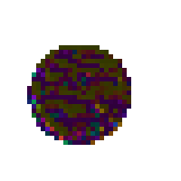

# PixelPet

一只"吃代码"长大的像素桌宠——基于神经细胞自动机（NCA），权重完全随机、无需训练。



## 特性

- **形态涌现**：每个个体的"物理定律"（神经网络权重）完全随机生成，从 5 颗种子像素开始生长。孵化器在沙盒中评估 24 组随机候选，只保留能长期维持形体、不碎裂、不漂移的"幸存者"——最终形态不可预测，但一定能活。
- **吃数据成长**：把代码文件丢进 `food/` 目录（或右键直接投喂），代码行数转化为能量池，能量决定 NCA 的步进速率（1~30 步/秒，每秒衰减）；没有食物就原地冻结。
- **领地约束（生长稳态）**：持续投喂也不会长满屏幕——尚未诞生的前沿格若离活体质心超过领地半径（0.28 × 网格边长），将不再苏醒。只拦出生、不杀细胞，边缘持续代谢但总面积稳定。
- **戳一戳**：左键短按在它身上戳个洞（半径 3 格），周围活格会慢慢长回来——修复同样需要能量，冻结的伤口不会愈合。左键长按拖动窗口，右键弹出菜单。
- **细节动画**：闲置时轻微呼吸脉动，辉光垫层，双八度余弦调色板 + 亮度调制。

## 运行

```bash
npm install
npm start
```

需要 Electron（Windows / macOS / Linux 均可）。启动后桌宠出现在屏幕右下角。

## 测试

```bash
npm test
```

40 项无头验证，覆盖：种子起点 / 形态涌现与长期稳定 / 数据驱动速度（能量→步速映射）/ 破坏与自我修复 / 生长稳态（长跑 1500 步填充率走平）/ 色彩与 alpha 映射 / 呼吸曲线 / 点击-拖动判定阈值 / 性能预算。

## 原理

每个像素 16 个通道（RGBA + 12 个隐藏态）。每帧：

1. **感知**：3×3 邻域上的 identity / Sobel-X / Sobel-Y 卷积 → 48 维
2. **更新**：48 → 128（ReLU）→ 16，逐格共享权重，残差连接
3. **活性掩码**：3×3 maxpool(alpha) > 0.1 才参与更新，孤立格清零
4. **随机更新**：每帧只有 70% 的活格"醒来"，打破同步性
5. **生长稳态**：领地外的前沿零态格被剔除出活性掩码（扩张截断）

权重不训练——随机初始化 + 存活力筛选。参考 Mordvintsev et al., *Growing Neural Cellular Automata*。

## 目录结构

```
src/
  nca.js       NCA 引擎（网格、感知、更新、孵化筛选、领地约束、破坏/修复）
  feeder.js    代码投喂器：扫描目录、行数计量、能量池衰减、能量→步速
  main.js      Electron 主进程：透明置顶窗口、投喂循环、右键菜单、窗口拖拽
  renderer.js  渲染端：Canvas 最近邻放大、数据驱动步进时钟、交互、呼吸/辉光
  interact.js  交互/动画纯函数（可单元测试）：拖动判定、呼吸曲线
  preload.js   contextBridge 暴露的最小 IPC 接口
test/
  validate.js  三条最小原型标准的无头验证
  interact.js  修复/动画/稳态的单元测试
  png.js       极简 PNG 编码器（测试快照用）
food/          饲料目录（把代码文件丢这里喂它）
```

## License

[MIT](LICENSE)
